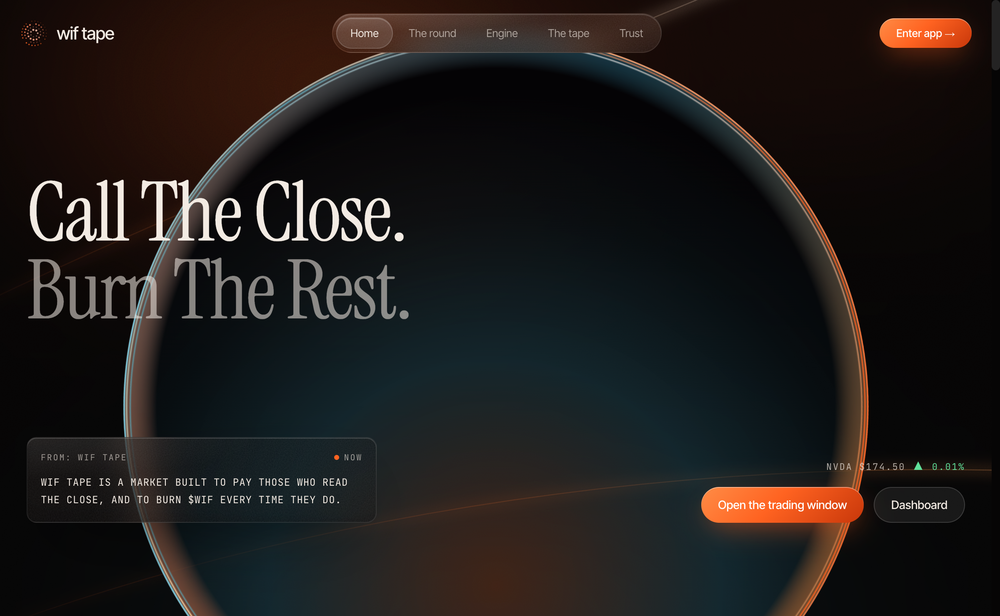
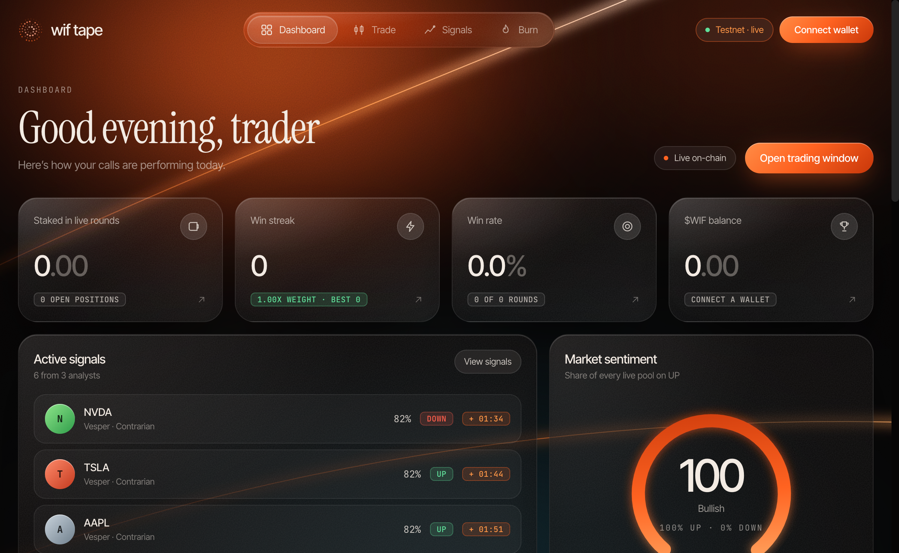
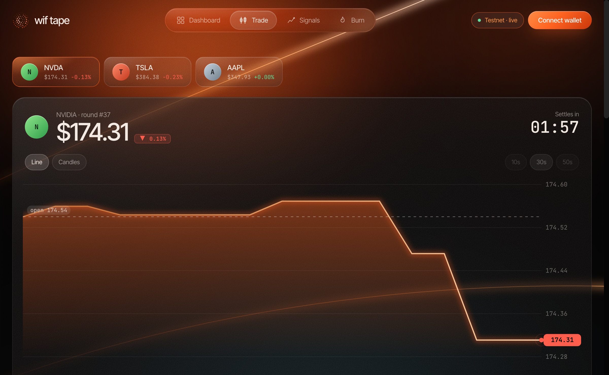
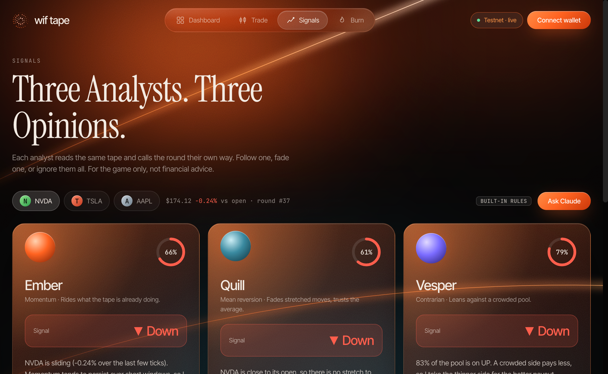
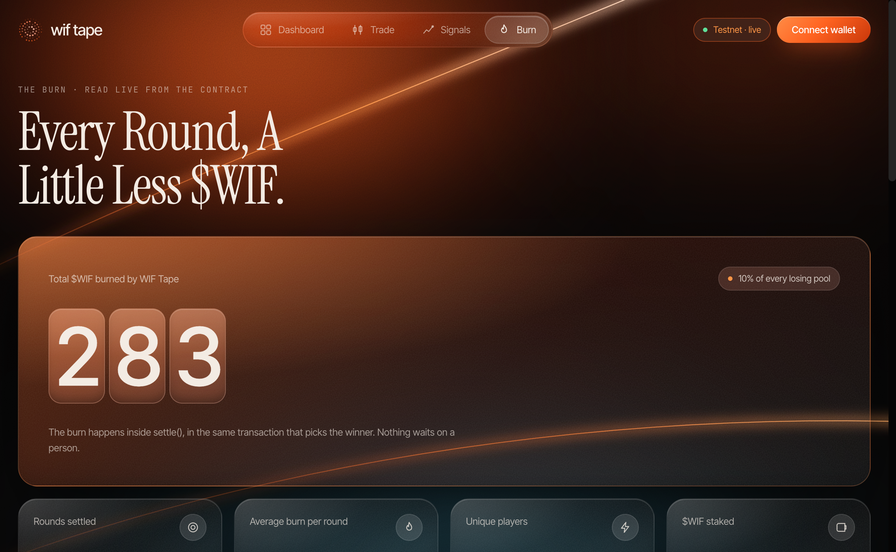
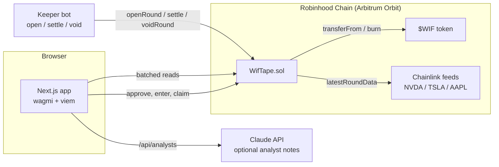
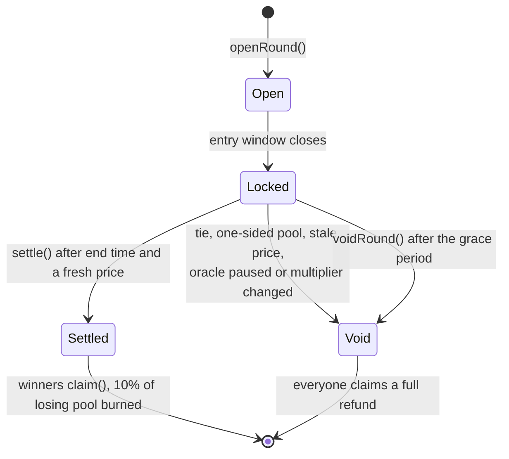
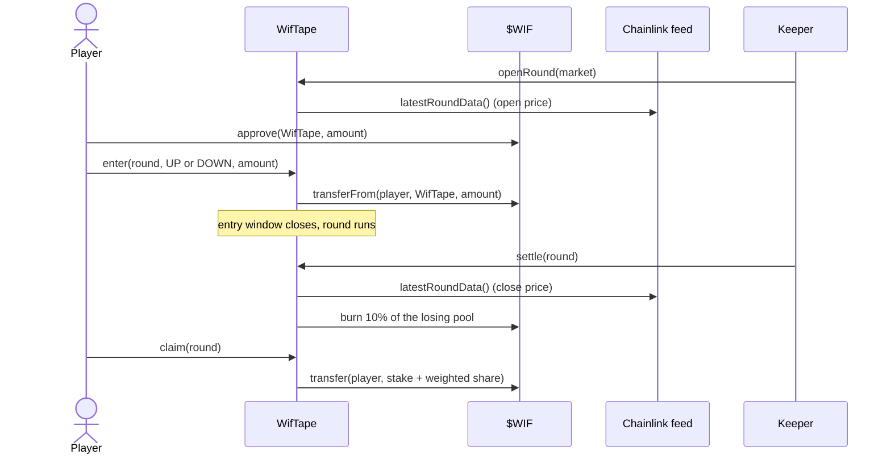
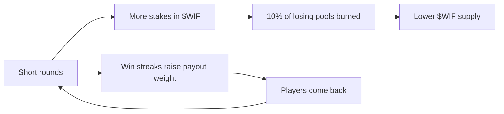

<div align="center">

# WIF Tape

**Call the close. Burn the rest.**

A round-based Stock Token prediction game played in **$WIF** on **Robinhood Chain**.
Chainlink settles every round, winners split the losing pool, and 10% of every losing pool is burned.

[](https://github.com/Shikhyy/wiftape/actions/workflows/ci.yml)




</div>

> Built for the [World is Flat](https://worldisflat.fun/build) hackathon. A game of skill. Not financial advice. 18+. $WIF has no promised value. Not available to US persons, or in Canada, the UK, Switzerland or any sanctioned jurisdiction. Not affiliated with Robinhood Markets, Inc.

## What it is

Pick a Stock Token (NVDA, TSLA, AAPL), call the next round **up** or **down**, and stake $WIF. When the round ends, the contract reads a Chainlink price and settles in the same transaction:

- **Winners** get their stake back plus a share of the net losing pool, weighted by their win streak (1.00x, +0.05x per win, up to 1.50x).
- **10% of the losing pool is burned** inside `settle()`. Every round makes $WIF scarcer, and nobody has to press a button for it to happen.
- **Anything unfair is void and refunded**: ties, one-sided pools, stale prices, a paused oracle, or a corporate action that changed the stock's multiplier mid-round.
- **Nobody holds the keys to the money.** Opening, settling and voiding rounds are permissionless. The owner can only add markets.

## The app

| | |
|---|---|
|  **Dashboard.** Live rounds, sentiment, recent trades and a watchlist. |  **Trade.** Chart, pool depth, live payouts and a one-tap order panel. |
|  **Signals.** Three analysts with three opinions. Rule-based by default, Claude on request. |  **Burn.** Total burned and every burn, read live from the contract. |

## How it works



### Round lifecycle



### One round, end to end



### The flywheel



## Safety model

- **Solvency by construction.** Total payouts plus the burn never exceed total stakes. A fuzz test checks this across random pools, sides and streaks.
- **Void instead of guess.** Stale price, paused oracle, a Stock Token corporate action, ties and one-sided pools all refund everyone.
- **No admin on funds.** The owner can only add markets. There is no pause, no withdraw and no parameter changes on live money.
- **Permissionless liveness.** Anyone can open, settle or void a round, so the game does not depend on one keeper.
- **Geo and eligibility.** App-side middleware returns 451 for blocked countries, and orders require an eligibility confirmation.

Run the 34 tests (29 on the core contract, 5 on the testnet helpers) with `forge test`.

## Live on Robinhood Chain testnet

The same contract and keeper run on testnet (chain 46630) with a free test token and Chainlink-shaped test feeds. The pricer bot mirrors the real mainnet Chainlink price and adds a small simulated move so short rounds are not all ties, so testnet prices are **not market data**, and tWIF is **not $WIF**.

| Contract | Address |
|---|---|
| WifTape | [`0xD5629c22f9e1cb1E037Edb191dbc87a44670eA04`](https://explorer.testnet.chain.robinhood.com/address/0xD5629c22f9e1cb1E037Edb191dbc87a44670eA04) |
| TestWif (tWIF) | [`0xB566B9CFB766a4F654C199eF206058a34BDBF574`](https://explorer.testnet.chain.robinhood.com/address/0xB566B9CFB766a4F654C199eF206058a34BDBF574) |
| NVDA test feed | [`0x11AaA61c920d6FeD6753C6cD4013012Bcd45B183`](https://explorer.testnet.chain.robinhood.com/address/0x11AaA61c920d6FeD6753C6cD4013012Bcd45B183) |
| TSLA test feed | [`0xA3841Ebd493bd1D54F46850Ab5222293f0615848`](https://explorer.testnet.chain.robinhood.com/address/0xA3841Ebd493bd1D54F46850Ab5222293f0615848) |
| AAPL test feed | [`0xF8B40b6D247689CD4eD70c1256826ABB3C657d3C`](https://explorer.testnet.chain.robinhood.com/address/0xF8B40b6D247689CD4eD70c1256826ABB3C657d3C) |

Network details for your wallet: RPC `https://rpc.testnet.chain.robinhood.com`, chain ID `46630`, symbol ETH, explorer `https://explorer.testnet.chain.robinhood.com`. Testnets can be reset, so these may stop working.

## Repo layout

```
contracts/   Foundry project: WifTape.sol, testnet helpers, tests, deploy scripts
web/         Next.js 14 app (landing, dashboard, trade, signals, burn) and the bots in web/scripts
render.yaml  Render Blueprint: web service plus a free web service that hosts the bots
```

## Quick start

**Contracts** (needs [Foundry](https://book.getfoundry.sh/)):

```bash
cd contracts
forge install foundry-rs/forge-std --no-git
forge test
```

**Web app** (needs Node 20+):

```bash
cd web
cp .env.example .env.local
npm install
npm run dev
```

With no contract addresses the app runs in **demo mode**: rounds are simulated in the browser and labelled as such. To read the live testnet instead, put the testnet values in `.env.local`:

```bash
NEXT_PUBLIC_CHAIN_ID=46630
NEXT_PUBLIC_CHAIN_NAME="Robinhood Chain Testnet"
NEXT_PUBLIC_RPC_URL=https://rpc.testnet.chain.robinhood.com
NEXT_PUBLIC_EXPLORER_URL=https://explorer.testnet.chain.robinhood.com
NEXT_PUBLIC_TAPE_ADDRESS=0xD5629c22f9e1cb1E037Edb191dbc87a44670eA04
NEXT_PUBLIC_WIF_ADDRESS=0xB566B9CFB766a4F654C199eF206058a34BDBF574
NEXT_PUBLIC_WIF_DECIMALS=18
NEXT_PUBLIC_TEST_FAUCET=true
```

Connect a wallet that supports custom networks, press **Get 1,000 tWIF**, and trade.

## Run your own testnet deployment

1. Fund a throwaway deployer with testnet ETH from the [faucet](https://faucet.testnet.chain.robinhood.com).
2. From `contracts/`: `forge script script/DeployTestnet.s.sol --rpc-url https://rpc.testnet.chain.robinhood.com --broadcast` (reads `PRIVATE_KEY` from your environment; never commit it).
3. From `web/`: run `scripts/testnet-setup.mjs` to create throwaway bot wallets and write the git-ignored `.env.testnet`.
4. From `web/`: `npm run testnet` starts the pricer, keeper and seeder bots under a supervisor that restarts them.
5. `npm run e2e:testnet` plays one full round as a brand-new wallet and checks every step (5 to 7 minutes).

## Deploy

Vercel cannot run the bots (serverless functions do not stay alive), so host the web app and the bots separately.

**Web app on Vercel.** Import the repo, set **Root Directory** to `web`, add the `NEXT_PUBLIC_*` variables above (and optionally `ANTHROPIC_API_KEY`), and deploy. The geo block reads Vercel's `x-vercel-ip-country` header.

**Everything on Render.** Use **New, Blueprint** and point it at this repo. `render.yaml` creates the web service and a second free web service that runs the bots (`node scripts/run-testnet.mjs`, which serves a health check on `$PORT`). Free services sleep after 15 minutes without traffic, so point a free uptime monitor such as UptimeRobot at the bots service URL every 5 minutes. Secret values (`PUSHER_PRIVATE_KEY`, `KEEPER_PRIVATE_KEY`, the six `SEEDER_*` keys) are marked `sync: false`, so you enter them in the dashboard and they never touch git.

## Configuration

| Variable | Where | Purpose |
|---|---|---|
| `NEXT_PUBLIC_CHAIN_ID`, `NEXT_PUBLIC_RPC_URL`, `NEXT_PUBLIC_EXPLORER_URL` | web, bots | Which chain to read and write |
| `NEXT_PUBLIC_TAPE_ADDRESS`, `NEXT_PUBLIC_WIF_ADDRESS` | web, bots | Contracts. Both must be set for live mode |
| `NEXT_PUBLIC_TEST_FAUCET` | web | Show the testnet faucet button |
| `ANTHROPIC_API_KEY` | web (server) | Optional. Without it the analysts use built-in rules |
| `KEEPER_PRIVATE_KEY`, `PUSHER_PRIVATE_KEY`, `SEEDER_*_PRIVATE_KEY` | bots | Throwaway testnet wallets. Never reuse them |

## Tech

Solidity 0.8.24 and Foundry, Chainlink AggregatorV3, Next.js 14 (App Router), TypeScript, Tailwind, wagmi 2 and viem 2, TanStack Query, and the Anthropic SDK for optional analyst notes.

## Notes

- Never commit private keys. `.env*` and `.testnet-wallet.json` are git-ignored.
- Seeded testnet pools come from bots, not real users.
- Mainnet deployment with real $WIF is separate from this testnet demo.

## License

[MIT](LICENSE)
